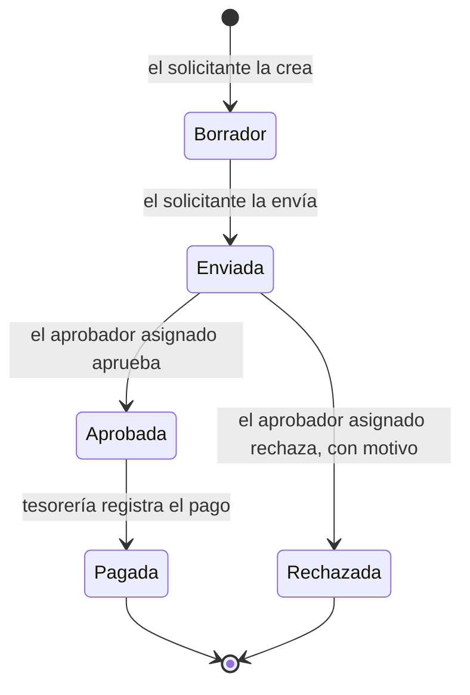

# Solicitudes de pago con aprobación (`payment_request`)

Módulo para **Odoo 18** que lleva a Odoo las solicitudes de pago a proveedores de Distribuidora Andina C.A. (ficticia): un empleado pide el pago, lo aprueba quien corresponde según el monto, tesorería lo paga y queda registrado en contabilidad.

## Estado por tramo

| Tramo | Estado |
|---|---|
| A | Pendiente |
| B | Pendiente |
| C | Fuera de alcance (ver *Supuestos y preguntas al cliente*) |

## Análisis del requerimiento

### El problema hoy

Las solicitudes de pago a proveedores llegan por WhatsApp. No quedan registradas en ningún sistema: nadie sabe con certeza cuáles se aprobaron, quién las aprobó ni por qué se rechazó una. Tesorería paga sobre mensajes sueltos, y contabilidad no tiene un respaldo de cada pago.

### Quiénes participan

| Rol | Qué hace |
|---|---|
| **Solicitante** (cualquier empleado) | Pide el pago: proveedor, monto, moneda y concepto. Una vez enviada, ya no puede cambiar la solicitud. |
| **Aprobador** | Aprueba o rechaza. Los pagos normales los aprueba el jefe del área y los grandes, gerencia. Si rechaza, dice por qué. |
| **Tesorería** | Paga las solicitudes aprobadas desde un diario de banco o de caja. |
| **Contabilidad** | Recibe el pago ya registrado y lo concilia con la factura del proveedor. |

### Flujo propuesto

- **Borrador:** solo la ve y la edita su solicitante.
- **Enviada:** ya no se puede modificar. Odoo elige el aprobador según el monto y le crea una tarea.
- **Aprobada:** queda registrado quién aprobó y cuándo.
- **Rechazada:** el motivo queda en el historial de la solicitud y el solicitante recibe el aviso.
- **Pagada:** existe un pago contable a proveedor vinculado a la solicitud, y la solicitud se puede imprimir para la carpeta del proveedor.

### Lo que el correo pide sin decirlo

| Lo que dice Carolina | Lo que implica |
|---|---|
| "Una vez enviada, la solicitud ya no se pueda cambiar" | El bloqueo debe valer en el servidor, no solo en la pantalla: nadie puede cambiar monto, proveedor ni concepto después de enviar, ni por la interfaz ni por la API. |
| "Los pagos normales los aprueba el jefe del área, pero los grandes los tiene que aprobar gerencia" | Hace falta un umbral configurable y un aprobador por nivel. Solo el aprobador asignado puede aprobar, no cualquiera con permisos de aprobador. |
| "Si se rechaza, el empleado tiene que saber por qué" | El motivo es obligatorio y le llega al solicitante, no solo un cambio de estado. |
| "Cuando tesorería pague, que quede registrado en contabilidad" | El pago tiene que ser un pago contable real (`account.payment`), vinculado a la solicitud, y no se puede pagar dos veces. |
| "Que podamos imprimir la solicitud para la carpeta del proveedor" | Un PDF con quién aprobó y cuándo, que sirva de respaldo en papel. |
| "Muchos proveedores nos facturan en dólares pero les pagamos en bolívares" | La solicitud necesita moneda propia, y al pagar en bolívares hay que aplicar una tasa de cambio. |
| "Nadie sabe cuáles se aprobaron" | Cada paso debe quedar en el historial (chatter) y debe poder filtrarse por estado. |

### Lo que Odoo ya trae

Antes de programar se revisó qué resuelve Odoo 18 sin un módulo nuevo:

| Necesidad | En Odoo 18 | Conclusión |
|---|---|---|
| Aprobaciones genéricas | La app *Aprobaciones* existe, pero es de la edición Enterprise; esta instalación es Community. | Hace falta un módulo propio. Con Enterprise, *Aprobaciones* sería la primera opción a evaluar. |
| Aprobación según el monto | Compras tiene doble validación por monto, pero aprueba **órdenes de compra**, no pagos. | No cubre el caso: muchos pagos no nacen de una orden de compra. |
| Registrar el pago a proveedor | El pago a proveedor de Contabilidad (`account.payment`) ya lo hace. | Se reutiliza: la solicitud crea ese pago, no uno paralelo. |
| Historial, avisos y tareas | El chatter y las actividades de Odoo. | Se reutilizan: historial completo y tarea para el aprobador. |
| Numeración | Secuencias de Odoo. | Las solicitudes se numeran `SP/2026/0001`. |
| Dólares y bolívares | Monedas, tasas de cambio y localización venezolana. | Se reutilizan. |
| Documento impreso | Reportes PDF de Odoo con el encabezado de la compañía. | Se reutilizan. |

El módulo solo agrega lo que falta: la solicitud con su flujo, los niveles de aprobación, el control de quién puede hacer cada paso y el vínculo con el pago contable.

## Supuestos y preguntas al cliente

Preguntas para Carolina y el supuesto con el que se avanzó mientras no hay respuesta. Si la respuesta cambia, se ajusta la configuración o el módulo.

| # | Pregunta | Supuesto para avanzar |
|---|---|---|
| 1 | ¿Quién es el "jefe del área" de cada empleado? ¿Tienen departamentos definidos? | Los aprobadores se configuran por niveles de monto, con un aprobador fijo por nivel. No se depende de Recursos Humanos. |
| 2 | ¿Desde qué monto un pago es "grande"? ¿Ese monto está en dólares o en bolívares? | Los montos de cada nivel son configurables y están en la moneda de la compañía. Una solicitud en otra moneda se convierte a la tasa del día de la solicitud para elegir el nivel. |
| 3 | ¿Los pagos grandes los aprueba solo gerencia, o primero el jefe del área y después gerencia? | Una sola aprobación: la del nivel que corresponde al monto. |
| 4 | ¿Alguien puede aprobar su propia solicitud? | No. Si el aprobador del nivel es el mismo solicitante, la solicitud pasa al nivel siguiente; si no hay un nivel superior, no se puede enviar. |
| 5 | Una solicitud rechazada, ¿se corrige y se vuelve a enviar? | No: queda rechazada como registro. El empleado crea una nueva, y puede duplicar la anterior. |
| 6 | ¿Se paga siempre el monto completo de una vez? | Sí: un solo pago por el total. |
| 7 | ¿La solicitud corresponde a una factura de proveedor ya registrada o es un pago sin factura, como un anticipo? | La solicitud es independiente de la factura. Contabilidad concilia el pago con la factura después. |
| 8 | Para las facturas en dólares que se pagan en bolívares, ¿qué tasa se usa (por ejemplo, la del BCV del día del pago)? ¿Quién carga las tasas en Odoo? | Se usa la tasa registrada en Odoo para el día del pago, cargada por contabilidad. El pago en bolívares de una solicitud en dólares queda para una siguiente etapa (tramo C). |
| 9 | ¿Qué tiene que mostrar la solicitud impresa? ¿Lleva firmas? | Los datos de la solicitud, quién la aprobó y cuándo, y los datos del pago. Sin espacios para firma. |
| 10 | ¿Hay que adjuntar la factura o la cotización del proveedor? | Es opcional: se adjunta en el historial de la solicitud. |
| 11 | ¿Trabajan con una sola empresa o con varias? | Con una (varias empresas queda para el tramo C). |
| 12 | ¿Quién define los niveles y los montos de aprobación? | El administrador del sistema. |
| 13 | ¿Qué pasa si el aprobador está de vacaciones o ausente? | Un administrador cambia el aprobador del nivel. Las solicitudes ya enviadas conservan el aprobador que tenían. |
| 14 | "Cualquier empleado puede pedir un pago": ¿todos los usuarios de Odoo? | Sí: todo usuario interno puede crear solicitudes. |
