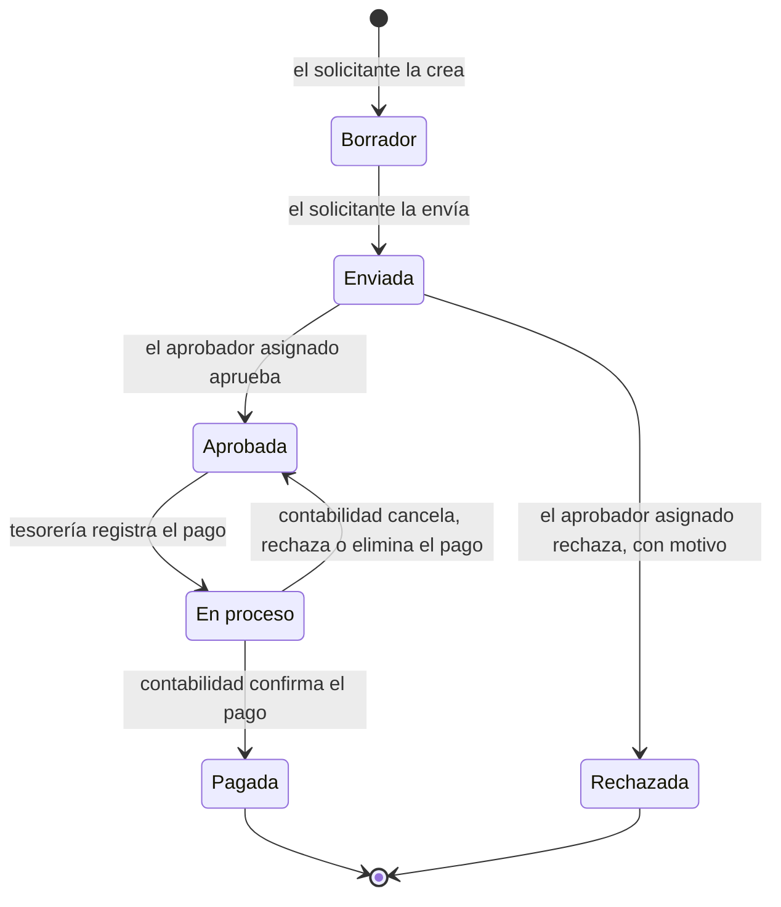

# Solicitudes de pago con aprobación (`payment_request`)

Módulo para **Odoo 18** que lleva a Odoo las solicitudes de pago a proveedores de Distribuidora Andina C.A. (ficticia): un empleado pide el pago, lo aprueba quien corresponde según el monto, tesorería lo paga y queda registrado en contabilidad.

## Estado por tramo

| Tramo | Estado | Detalle |
|---|---|---|
| A | Completo | Solicitud con secuencia, flujo de estados, grupos *Solicitante*, *Aprobador* y *Tesorería*, vistas y menú. Los permisos se validan en el servidor, no solo en los botones. |
| B | Completo | Niveles de aprobación por monto, actividad para el aprobador, asistente de rechazo con motivo, asistente de pago que crea el `account.payment` de proveedor y reporte PDF. |
| C | No implementado | Lo que falta y lo que ya cubre Odoo está en *Limitaciones conocidas y pendientes*. |

Además de lo que pide el enunciado: la solicitud sigue el estado contable de su pago (*En proceso* hasta que contabilidad lo confirma, y entonces *Pagada*) y vuelve a *Aprobada* si contabilidad cancela o rechaza ese pago, y todos los textos están traducidos al español.

## Qué hace

- **Cualquier empleado** crea una solicitud de pago: proveedor, monto, moneda, fecha y concepto. Se numera `SP/2026/0001` y, una vez enviada, ya no se puede modificar.
- **Al enviarla**, Odoo elige el nivel de aprobación según el monto, le asigna el aprobador de ese nivel y le crea una actividad.
- **Solo el aprobador asignado** la aprueba o la rechaza. El rechazo pide un motivo, que queda en el historial y le llega al solicitante.
- **Tesorería** paga las solicitudes aprobadas con un asistente: elige el diario de banco o de caja y la fecha, y el módulo crea y publica el pago a proveedor de Contabilidad, vinculado a la solicitud. La solicitud queda *En proceso* y pasa sola a *Pagada* cuando contabilidad confirma el pago.
- **El PDF** de la solicitud muestra quién la aprobó y cuándo, y los datos del pago.

## Análisis del requerimiento

### El problema hoy

Las solicitudes de pago a proveedores llegan por WhatsApp. No quedan registradas en ningún sistema: nadie sabe con certeza cuáles se aprobaron, quién las aprobó ni por qué se rechazó una. Tesorería paga sobre mensajes sueltos, y contabilidad no tiene un respaldo de cada pago.

### Quiénes participan

| Rol | Qué hace |
|---|---|
| **Solicitante** (cualquier empleado) | Pide el pago: proveedor, monto, moneda y concepto. Una vez enviada, ya no puede cambiar la solicitud. |
| **Aprobador** | Aprueba o rechaza. Los pagos normales los aprueba el jefe del área y los grandes, gerencia. Si rechaza, dice por qué. |
| **Tesorería** | Paga las solicitudes aprobadas desde un diario de banco o de caja. |
| **Contabilidad** | Recibe el pago ya registrado y lo concilia con la factura del proveedor. Si cancela o rechaza el pago, la solicitud vuelve a *Aprobada*. |

### Flujo propuesto



- **Borrador:** solo la ve y la edita su solicitante.
- **Enviada:** ya no se puede modificar. Odoo elige el aprobador según el monto y le crea una tarea.
- **Aprobada:** queda registrado quién aprobó y cuándo.
- **Rechazada:** el motivo queda en el historial de la solicitud y el solicitante recibe el aviso.
- **En proceso:** existe un pago contable a proveedor vinculado a la solicitud, registrado por tesorería y pendiente de que contabilidad lo confirme. La solicitud ya se puede imprimir para la carpeta del proveedor.
- **Pagada:** contabilidad confirmó el pago. La solicitud pasa sola a este estado cuando el pago contable llega a *Pagado*.

### Lo que el correo pide sin decirlo

| Lo que dice Carolina | Lo que implica |
|---|---|
| "Una vez enviada, la solicitud ya no se pueda cambiar" | El bloqueo debe valer en el servidor, no solo en la pantalla: nadie puede cambiar monto, proveedor ni concepto después de enviar, ni por la interfaz ni por la API. |
| "Los pagos normales los aprueba el jefe del área, pero los grandes los tiene que aprobar gerencia" | Hace falta un umbral configurable y un aprobador por nivel. Solo el aprobador asignado puede aprobar, no cualquiera con permisos de aprobador. |
| "Si se rechaza, el empleado tiene que saber por qué" | El motivo es obligatorio y le llega al solicitante, no solo un cambio de estado. |
| "Cuando tesorería pague, que quede registrado en contabilidad" | El pago tiene que ser un pago contable real (`account.payment`), vinculado a la solicitud, y no se puede pagar dos veces. |
| "Que podamos imprimir la solicitud para la carpeta del proveedor" | Un PDF con quién aprobó y cuándo, que sirva de respaldo en papel. |
| "Muchos proveedores nos facturan en dólares pero les pagamos en bolívares" | La solicitud necesita moneda propia, y al pagar en bolívares hay que aplicar una tasa de cambio. |
| "Nadie sabe cuáles se aprobaron" | Cada paso debe quedar en el historial (chatter) y debe poder filtrarse por estado. |

### Lo que Odoo ya trae

Antes de programar se revisó qué resuelve Odoo 18 sin un módulo nuevo:

| Necesidad | En Odoo 18 | Conclusión |
|---|---|---|
| Aprobaciones genéricas | La app *Aprobaciones* existe, pero es de la edición Enterprise; esta instalación es Community. | Hace falta un módulo propio. Con Enterprise, *Aprobaciones* sería la primera opción a evaluar. |
| Aprobación según el monto | Compras tiene doble validación por monto, pero aprueba **órdenes de compra**, no pagos. | No cubre el caso: muchos pagos no nacen de una orden de compra. |
| Registrar el pago a proveedor | El pago a proveedor de Contabilidad (`account.payment`) ya lo hace. | Se reutiliza: la solicitud crea ese pago, no uno paralelo. |
| Historial, avisos y tareas | El chatter y las actividades de Odoo. | Se reutilizan: historial completo y tarea para el aprobador. |
| Numeración | Secuencias de Odoo. | Las solicitudes se numeran `SP/2026/0001`. |
| Dólares y bolívares | Monedas, tasas de cambio y localización venezolana. | Se reutilizan. |
| Documento impreso | Reportes PDF de Odoo con el encabezado de la compañía. | Se reutilizan. |

El módulo solo agrega lo que falta: la solicitud con su flujo, los niveles de aprobación, el control de quién puede hacer cada paso y el vínculo con el pago contable.

## Decisiones de diseño

### Permisos

| Grupo | Ve | Puede |
|---|---|---|
| *Solicitante* (todo usuario interno) | Solo sus solicitudes | Crearlas, editarlas y eliminarlas mientras están en borrador, y enviarlas |
| *Aprobador* | Todas | Aprobar o rechazar las que tiene asignadas |
| *Tesorería* (incluye el grupo *Facturación* de Contabilidad, necesario para registrar pagos) | Todas | Pagar las aprobadas |
| Administrador (*Ajustes*) | — | Configurar los niveles de aprobación |

- **Las reglas valen en el servidor.** Los botones se ocultan según el estado y el grupo, pero cada acción vuelve a comprobar en Python el grupo, el estado y, al aprobar o rechazar, que el usuario sea el aprobador asignado. Llamar al método directamente, por ejemplo por RPC, da el mismo error que el botón. Los campos del negocio (proveedor, monto, moneda, concepto, fecha, solicitante) se bloquean en `write` después de enviar, y solo se eliminan borradores.
- **`sudo()` en dos lugares, a propósito:**
  1. Los datos del pago que muestra la solicitud (referencia, fecha, diario y estado) son campos relacionados, que Odoo calcula como superusuario. Así el solicitante los ve sin tener acceso a Contabilidad, y solo ve esos cuatro datos.
  2. Cuando contabilidad cancela, rechaza o elimina un pago, la solicitud se actualiza con `sudo()`, porque el contador puede no tener acceso a ella por la regla de registro. Solo cambia el estado y el vínculo, y deja una nota en el historial.
- **El botón del pago hacia su solicitud** solo lo ven aprobadores y tesorería. Un contador sin esos roles ve el número de la solicitud en la referencia (*memo*) del pago.

### Niveles de aprobación

- Cada nivel tiene un monto mínimo, en la moneda de la compañía, y un aprobador, que debe tener el grupo *Aprobador*.
- Al enviar, el monto se convierte a la moneda de la compañía con la tasa de la fecha de la solicitud, y se toma el nivel con el mayor monto mínimo que ese valor alcanza.
- Si el aprobador de ese nivel es el propio solicitante, la solicitud pasa al nivel siguiente. Si no hay nivel aplicable, o no hay otro aprobador, el envío falla con un mensaje que dice qué configurar.
- El aprobador recibe una actividad *Por hacer*, con el resumen en su idioma. Se cierra al aprobar o rechazar.
- El solicitante queda como seguidor de su solicitud al enviarla, así que recibe el aviso del rechazo con el motivo.

### El pago y su estado contable

- El asistente crea un `account.payment` de salida a proveedor por el monto y la moneda de la solicitud, con el diario y la fecha elegidos y el número de la solicitud como referencia. Lo publica y lo vincula a la solicitud en ambos sentidos.
- **No se puede pagar dos veces:** el pago exige que la solicitud esté *Aprobada*, y al pagar deja de estarlo.
- **La solicitud sigue el estado contable de su pago** (supuesto 15):
  - **En proceso:** tesorería registró el pago y está en contabilidad, contra la cuenta de pagos pendientes del diario, pero falta confirmarlo.
  - **Pagada:** contabilidad concilió el pago. En Odoo Community la conciliación bancaria no existe (es de Enterprise), así que el pago pasa a *Pagado* cuando contabilidad lo concilia con la factura del proveedor: en la factura, la sección *Débitos pendientes* lista los pagos del proveedor con el número de la solicitud, y se elige con *Agregar*. Si la factura es mayor que el pago, la factura queda en pago parcial y el pago, y la solicitud, siguen *En proceso*. Si el diario registra los pagos directo en la cuenta del banco, el pago queda *Pagado* al publicarse y la solicitud pasa a *Pagada* de una vez.
- **Cómo se sincroniza:** el estado de la solicitud es un campo calculado que depende del estado del pago. Odoo lo recalcula cuando el pago cambia, aunque el cambio venga de la conciliación y no de una escritura, y aunque lo haga un contador que no ve la solicitud. Los cambios quedan en el historial.
- **Si contabilidad cancela, rechaza o elimina el pago**, la solicitud vuelve a *Aprobada* con una nota en el historial, y tesorería la puede pagar de nuevo. Un pago devuelto a borrador conserva su solicitud, porque se corrige y se vuelve a publicar. Un pago ya reemplazado por otro no afecta la solicitud.

### Reporte PDF

Se imprime desde la solicitud (*Imprimir › Solicitud de pago*): número, proveedor, solicitante, fecha, monto, concepto y estado; quién aprobó y cuándo, o quién rechazó y por qué; y la referencia, el estado, la fecha y el diario del pago. Usa el encabezado de la compañía. El solicitante también lo puede imprimir.

## Puesta en marcha

1. **Moneda de la compañía: VES.** Odoo todavía asocia Venezuela con el VEF (bolívar fuerte), reemplazado por el VES en 2018, y al instalar el plan contable venezolano la compañía queda en VEF. Hay que cambiarla a VES en *Ajustes › Contabilidad* **antes del primer asiento**, porque después Odoo no lo permite, y archivar el VEF para que no aparezca al elegir moneda.
2. **Tasas de cambio:** contabilidad carga la tasa del dólar en *Contabilidad › Configuración › Monedas*. Para elegir el nivel, la solicitud usa la tasa de su fecha.
3. **Correo de cada usuario:** Odoo lo exige para registrar mensajes y avisar de actividades. Un usuario sin correo no puede enviar ni rechazar solicitudes ("configure the sender's email address").
4. **Grupos:** todo usuario interno ya es *Solicitante*. En el usuario, sección *Solicitudes de pago*, se marca *Aprobador* o *Tesorería*. Al instalar, el administrador queda en los dos.
5. **Niveles de aprobación:** *Solicitudes de pago › Configuración › Niveles de aprobación* (solo el administrador). Por ejemplo: "Área" desde 0 VES con el jefe de área, y "Gerencia" desde 50.000 VES con el gerente.

**Al actualizar desde la versión 18.0.1.0.0**, en la que una solicitud quedaba *Pagada* apenas tesorería registraba el pago, el script `migrations/18.0.1.1.0/post-migrate.py` alinea cada solicitud pagada con el estado de su pago: las que tienen el pago sin confirmar pasan a *En proceso*.

## Cómo probarlo

### Pruebas automáticas

```bash
./odoo test prueba_tecnica payment_request -d prueba_limpia
```

Son 36 pruebas y cubren el 99% del código. Todas actúan con usuarios reales de cada grupo, nunca como superusuario, para que los permisos se prueben de verdad. Cada criterio del enunciado tiene su prueba:

| Criterio del enunciado | Prueba |
|---|---|
| **A** — El solicitante ve solo sus solicitudes | `test_requester_sees_only_own_requests` |
| **A** — No puede aprobar, ni desde el botón ni llamando al método | `test_requester_cannot_approve`, `test_buttons_only_for_their_group` |
| **A** — Una solicitud enviada no se edita | `test_submitted_request_cannot_be_modified` |
| **A** — No se permite un monto cero o negativo | `test_amount_must_be_positive` |
| **A** — Los botones aparecen solo en el estado y el grupo que corresponde | `test_buttons_only_for_their_group`, `test_actions_only_in_their_status` |
| **A** — El flujo completo | `test_full_flow` |
| **B** — Solo el aprobador asignado puede aprobar | `test_only_assigned_approver_decides` |
| **B** — El motivo de rechazo queda en el chatter | `test_reject_requires_reason_and_posts_it` |
| **B** — El pago queda vinculado y visible desde la solicitud | `test_payment_creates_posted_supplier_payment`, `test_payment_and_request_are_linked_both_ways` |
| **B** — Una solicitud no se puede pagar dos veces | `test_request_cannot_be_paid_twice` |
| **B** — El PDF muestra quién aprobó y cuándo | `test_report_shows_who_approved_and_when` |

Las demás cubren la elección del nivel (también en otra moneda), la actividad del aprobador, el paso de *En proceso* a *Pagada* al conciliar el pago con la factura o al registrarlo directo en el banco, la reversión cuando contabilidad cancela o rechaza el pago, el script de migración y la traducción.

### Prueba manual

Con la configuración de *Puesta en marcha*, un usuario por rol (solicitante, jefe de área, gerente y tesorero) y dos niveles:

1. **Solicitante:** crea una solicitud de 500 VES y la envía. Queda asignada al jefe de área, que recibe una actividad.
2. **Jefe de área:** con el filtro *Por aprobar*, abre la solicitud y la aprueba.
3. **Tesorero:** *Pagar*, elige el diario y la fecha, y *Registrar pago*. La solicitud queda *En proceso*, igual que su pago, con un botón para abrirlo; desde el pago, otro botón vuelve a la solicitud.
4. **Imprimir › Solicitud de pago:** el PDF muestra quién aprobó y cuándo, y el pago.
5. Una solicitud de 2.000 USD (más de 50.000 VES a la tasa del día) va al gerente. Si el gerente la rechaza con un motivo, el solicitante recibe el aviso.
6. **Contabilidad:** registra la factura del proveedor por 500 VES y, en *Débitos pendientes*, *Agregar* el pago de la solicitud. El pago y la solicitud pasan a *Pagada*.
7. **Contabilidad:** en el pago de otra solicitud, *Marcar como enviado* y *Rechazar*, o *Cancelar*. La solicitud vuelve a *Aprobada* con una nota.

## Supuestos y preguntas al cliente

Preguntas para Carolina y el supuesto con el que se avanzó mientras no hay respuesta. Si la respuesta cambia, se ajusta la configuración o el módulo.

| # | Pregunta | Supuesto para avanzar |
|---|---|---|
| 1 | ¿Quién es el "jefe del área" de cada empleado? ¿Tienen departamentos definidos? | Los aprobadores se configuran por niveles de monto, con un aprobador fijo por nivel. No se depende de Recursos Humanos. |
| 2 | ¿Desde qué monto un pago es "grande"? ¿Ese monto está en dólares o en bolívares? | Los montos de cada nivel son configurables y están en la moneda de la compañía. Una solicitud en otra moneda se convierte a la tasa del día de la solicitud para elegir el nivel. |
| 3 | ¿Los pagos grandes los aprueba solo gerencia, o primero el jefe del área y después gerencia? | Una sola aprobación: la del nivel que corresponde al monto. |
| 4 | ¿Alguien puede aprobar su propia solicitud? | No. Si el aprobador del nivel es el mismo solicitante, la solicitud pasa al nivel siguiente; si no hay un nivel superior, no se puede enviar. |
| 5 | Una solicitud rechazada, ¿se corrige y se vuelve a enviar? | No: queda rechazada como registro. El empleado crea una nueva, y puede duplicar la anterior. |
| 6 | ¿Se paga siempre el monto completo de una vez? | Sí: un solo pago por el total. |
| 7 | ¿La solicitud corresponde a una factura de proveedor ya registrada o es un pago sin factura, como un anticipo? | La solicitud es independiente de la factura. Contabilidad concilia el pago con la factura después. |
| 8 | Para las facturas en dólares que se pagan en bolívares, ¿qué tasa se usa (por ejemplo, la del BCV del día del pago)? ¿Quién carga las tasas en Odoo? | Se usa la tasa registrada en Odoo para el día del pago, cargada por contabilidad. El pago en bolívares de una solicitud en dólares queda para una siguiente etapa (tramo C). |
| 9 | ¿Qué tiene que mostrar la solicitud impresa? ¿Lleva firmas? | Los datos de la solicitud, quién la aprobó y cuándo, y los datos del pago. Sin espacios para firma. |
| 10 | ¿Hay que adjuntar la factura o la cotización del proveedor? | Es opcional: se adjunta en el historial de la solicitud. |
| 11 | ¿Trabajan con una sola empresa o con varias? | Con una (varias empresas queda para el tramo C). |
| 12 | ¿Quién define los niveles y los montos de aprobación? | El administrador del sistema. |
| 13 | ¿Qué pasa si el aprobador está de vacaciones o ausente? | Un administrador cambia el aprobador del nivel. Las solicitudes ya enviadas conservan el aprobador que tenían. |
| 14 | "Cualquier empleado puede pedir un pago": ¿todos los usuarios de Odoo? | Sí: todo usuario interno puede crear solicitudes. |
| 15 | ¿Cuándo está "pagada" una solicitud: cuando tesorería registra el pago o cuando el banco lo confirma? | Cuando contabilidad confirma el pago. Mientras tanto la solicitud está *En proceso*, igual que su pago contable. |
| 16 | Si contabilidad cancela o rechaza un pago ya registrado, ¿qué pasa con la solicitud? | Vuelve a *Aprobada*, con una nota en el historial, y tesorería la paga de nuevo. Un pago devuelto a borrador para corregirlo conserva su solicitud, que sigue *En proceso*. |
| 17 | ¿Contabilidad necesita ver las solicitudes? | Solo quien tenga el rol de aprobador o de tesorería. El resto de contabilidad ve el número de la solicitud en la referencia del pago. |

## Limitaciones conocidas y pendientes

**Tramo C, no implementado.** Para cada punto, lo que ya hace el módulo y lo que falta:

- **Solicitud en USD pagada desde un diario en VES:** hoy el pago se crea en la moneda de la solicitud, USD, aunque el diario sea en bolívares, y Odoo registra el asiento en VES con la tasa de la fecha del pago. Falta que el pago se haga por el monto en VES y una prueba que verifique ese monto.
- **Varias compañías:** solicitudes y niveles tienen compañía y reglas de registro por compañía, pero no hay pruebas con dos compañías.
- **Dos aprobadores al mismo tiempo:** cada solicitud tiene un solo aprobador asignado, lo que reduce el caso, pero no hay bloqueo en la base de datos. Dos sesiones que aprueban y rechazan a la vez no están protegidas.
- **Falla al crear el pago:** el pago y el cambio a *En proceso* ocurren en la misma transacción; si publicar el pago falla, Odoo revierte todo y la solicitud sigue *Aprobada*. No hay prueba que lo demuestre.
- **`ARCHITECTURE.md`:** no se escribió.

**Otras limitaciones:**

- **En Odoo Community el pago y la solicitud quedan *En proceso*** hasta que contabilidad concilia el pago con la factura del proveedor, porque la conciliación bancaria es de Enterprise. Un pago sin factura, como un anticipo, deja la solicitud *En proceso* hasta que llegue la factura y se concilie.
- **Un pago rechazado sigue apareciendo en las facturas del proveedor.** En Odoo, *Rechazar* solo cambia el estado del pago y deja su asiento publicado, así que el pago sigue en *Débitos pendientes* y se podría conciliar con una factura por error, aunque la solicitud ya volvió a *Aprobada*. Después de rechazar un pago, contabilidad debe cancelarlo: así se cancela su asiento y deja de aparecer.
- **Odoo no deja eliminar un pago que ya tomó número** si no es el último de la secuencia; contabilidad tiene que cancelarlo o rechazarlo. En los dos casos la solicitud vuelve a *Aprobada*.
- **Un pago cancelado que contabilidad vuelve a publicar no vuelve a la solicitud**, que ya está *Aprobada* o pagada con otro pago. Evitar un pago duplicado en ese caso queda en manos de contabilidad.
- **El nivel se elige al enviar.** Si después cambian los niveles o el aprobador, las solicitudes enviadas conservan el que tenían (supuesto 13).
- **Sin tasa del día**, Odoo usa la última tasa anterior a la fecha de la solicitud, o la primera posterior si no hay anteriores. Si la moneda no tiene ninguna tasa cargada, la convierte 1 a 1, y el nivel elegido puede ser el equivocado.
